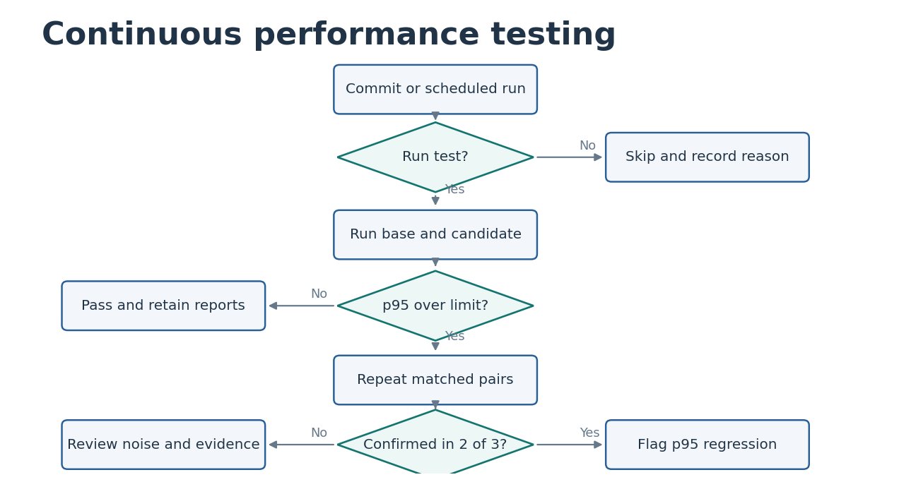

# Đề xuất Continuous Performance Testing

## Luồng trên commit

1. Theo dõi pull request và commit vào nhánh chính của SUT. Chạy phép đo nhanh khi có thay đổi ở backend, schema hoặc migration, dependency lockfile, config triển khai, fixture, hoặc runner. Bỏ lượt nhanh nếu chỉ đổi tài liệu hay UI. Chạy bộ dài theo lịch để phát hiện tác động từ dependency, hạ tầng và thay đổi chưa được bộ lọc nhận diện.
2. Khởi động hai bản từ commit nền và commit cần kiểm trên cùng runner cố định. Giữ phiên bản Java, JMeter, Node, snapshot DB, kích thước fixture, profile và thời gian warm-up giống nhau. Đo nối tiếp để hai bản dùng cùng tài nguyên, reset DB ở mỗi lượt và lưu JTL, report HTML, tài nguyên và checksum.
3. So p95 của từng HTTP sampler trong plateau khi mỗi sampler có ít nhất 100 mẫu. Đánh dấu ứng viên khi p95 tăng trên 20% **và** trên 20 ms. Theo dõi tỷ lệ lỗi và throughput riêng. Với hiệu năng ngoài ngưỡng hoặc lỗi mới, chạy lại tối đa hai lần, đổi thứ tự base và candidate để kiểm ảnh hưởng của máy nóng hoặc I/O.
4. Flag hồi quy khi ít nhất hai trên ba cặp chạy vượt cùng ngưỡng trên cùng sampler. Báo giá trị nền, giá trị hiện tại, số mẫu, trạng thái tài nguyên và liên kết JTL. Lượt thiếu mẫu, crash runner hoặc tài nguyên lệch được đánh dấu cần kiểm tra phép đo. Kết quả đã xác nhận mới dùng để quyết định merge hoặc tạo issue.

## Đánh đổi

Profile nhanh giảm chi phí cho PR nhưng có thể bỏ sót hồi quy chỉ xuất hiện ở Stress, Spike hoặc khi lịch sử đơn tăng lâu. Dùng lịch chạy đầy đủ cho ba profile và endurance giúp bù phần này. Runner chuyên dụng và lặp cặp chạy tốn tài nguyên, đổi lại giảm nhiễu do shared CI. Ngưỡng tương đối kết hợp số ms tuyệt đối giảm cảnh báo từ mức nền nhỏ, ví dụ từ 2 lên 3 ms. Cố định fixture làm so sánh chính xác hơn, nhưng nên có thêm một fixture lớn theo lịch để kiểm tác động của kích thước DB.

Ngưỡng 20% và 20 ms là giá trị đề xuất ban đầu. Cần đo độ dao động trên nhiều lần cùng commit để hiệu chỉnh trước khi dùng làm điều kiện chặn.
